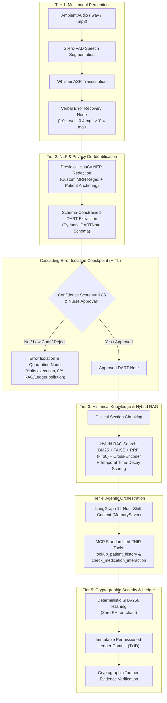

# Ambient Nursing Ally (ANA)

[](https://www.python.org/downloads/)
[](https://github.com/langchain-ai/langgraph)
[](https://hl7.org/fhir/)
[](https://www.hyperledger.org/use/fabric)

> **An AI-Powered Multimodal Clinical Documentation and Nursing Assistance System**  
> Developed using **Design Science Research (DSR)** and **Agile** engineering methodologies for inpatient hospital wards.

---

## 1. Executive Summary & Problem Statement

In inpatient hospital wards, nurses spend between **23% and 50% of an active 12-hour shift** manually typing clinical observations, vital signs, and medication administrations into Electronic Health Record (EHR) systems. This documentation burden leads to severe cognitive fatigue, charting delays, and burnout.

**Ambient Nursing Ally (ANA)** automates this workflow end-to-end:
1. **Listens ambiently** to nurse-patient interactions and verbal handoffs.
2. **Filters background noise** and transcribes clinical speech with mid-sentence self-correction recovery.
3. **De-identifies Protected Health Information (PHI)** using Microsoft Presidio and spaCy NER before structured formatting.
4. **Enforces strict schema constraints** into standard **DART (Data, Action, Response, Teaching)** nursing notes.
5. **Halts at a Cascading Error Isolation Checkpoint** for nurse review before permanent commits.
6. **Enriches historical context** via Hybrid RAG (BM25 + FAISS + RRF + Cross-Encoder with temporal decay).
7. **Queries EHR data safely** using standardized Model Context Protocol (MCP) `@tool` decorators against Smart-on-FHIR APIs (administrative scope, non-SaMD).
8. **Anchors off-chain records** to an immutable permissioned ledger using deterministic SHA-256 fingerprints with **zero on-chain PHI**.

---

## 2. 5-Tier Architecture Overview



---

## 3. Repository Directory Structure

```
c:/Projects/ANA/
├── datasets/                            # Synthetic corpora & benchmark audio
│   ├── MIMIC_IV_Trasncript.csv.xls      # Local clinical note dataset (gitignored)
│   ├── mock_audio.mp3                   # Inpatient ward simulated audio
│   ├── segmented_audio.wav              # VAD-segmented speech audio
│   └── mock_fhir_records.json           # Synthetic Smart-on-FHIR EHR database
│
├── tier1_perception/                    # Tier 1: Acoustic & Speech Perception
│   ├── __init__.py
│   ├── audio_pipeline.py                # Silero-VAD + Whisper ASR + Verbal Rollback
│   └── vlm_batch_parser.py              # Vision-Language Model monitor parsing
│
├── tier2_nlp/                           # Tier 2: De-Identification & DART NLP
│   ├── __init__.py
│   ├── redaction_pipeline.py            # Presidio + spaCy NER + MRN regex
│   ├── dart_pipeline.py                 # Schema-constrained DART JSON (Pydantic)
│   └── chunking_pipeline.py             # Section header chunking
│
├── tier3_rag/                           # Tier 3: Hybrid Knowledge Retrieval
│   ├── __init__.py
│   ├── vector_store_pipeline.py         # FAISS bi-encoder dense index
│   └── hybrid_search_pipeline.py        # BM25 + FAISS + RRF + Cross-Encoder + Decay
│
├── tier4_agentic/                       # Tier 4: Agent State & MCP FHIR
│   ├── __init__.py
│   ├── agent_state_pipeline.py          # LangGraph MemorySaver 12-hour shift state
│   ├── mcp_fhir_pipeline.py             # MCP @tool decorators (lookup, safety check)
│   └── mock_fhir_api.py                 # Flask mock Smart-on-FHIR REST server
│
├── tier5_security/                      # Tier 5: Cryptographic Audit & Ledger
│   ├── __init__.py
│   ├── hash_pipeline.py                 # Deterministic SHA-256 serialization
│   ├── ledger_audit_pipeline.py         # Permissioned ledger client & tamper verification
│   └── chaincode/
│       └── clinical_audit_chaincode.go  # Hyperledger Fabric chaincode
│
├── main/                                # Master Pipeline Orchestrator
│   ├── __init__.py
│   └── ana_master_pipeline.py           # Primary deliverable state machine
│
├── configs/                             # Configuration files
│   └── pipeline_config.yaml             # Confidence thresholds & system params
│
├── tests/                               # Comprehensive Automated Test Suite
│   ├── test_tier1.py                    # VAD, ASR, verbal error recovery tests
│   ├── test_tier2.py                    # Redaction, DART validation tests
│   ├── test_tier3.py                    # Vector store, hybrid search, decay tests
│   ├── test_tier4.py                    # MCP tools, shift memory persistence tests
│   ├── test_tier5.py                    # SHA-256 deterministic hash, tamper tests
│   └── test_master_pipeline.py          # Full LangGraph integration tests
│
├── Documents/                           # Research documents, methodology & rubrics
├── ana_master_pipeline.py               # Root execution proxy
├── requirements.txt                     # Complete dependency manifest
└── README.md                            # Comprehensive system documentation
```

---

## 4. Key Architectural Innovations

### 1. Cascading Error Isolation Checkpoint (HITL)
To prevent hallucinations or incorrect transcription entries from polluting downstream knowledge stores or the blockchain, ANA implements a **halt-and-verify** node:
- **Threshold**: Confidence score $< 0.85$ or ambiguous clinical terminology flags mandatory Human-in-the-Loop review.
- **Routing**: If approved, data cascades into FAISS and Blockchain. If rejected, execution routes to `error_isolation_rollback_node`, logging the quarantine event without altering downstream state.

### 2. Verbal Error Recovery Node
Clinical nursing speech frequently contains immediate mid-sentence self-corrections:
> *"Administer 10... wait, 0.4 milligrams of sublingual nitroglycerin."*

ANA detects clinical hesitation markers (`wait,`, `scratch that,`, `correction:`) and rolls back the erroneous token before PII redaction and DART extraction.

### 3. Model Context Protocol (MCP) @tool Standard
Tools are decorated using `@tool` from `langchain-core` and strictly scoped for administrative flowsheet queries (`lookup_patient_history`, `check_medication_interaction`). This ensures non-SaMD regulatory compliance.

### 4. 12-Hour Shift Context Persistence
LangGraph `MemorySaver` tracks session threads across an entire 12-hour nursing shift. Patient context anchoring ensures observations in multi-bed rooms do not suffer from identity crossover.

### 5. Deterministic Zero-PHI Hash Anchoring
To comply with HIPAA and GDPR, zero PHI is written to the blockchain. Instead, the serialized DART note is hashed using deterministic SHA-256 (keys sorted). Only the resulting 64-character hexadecimal digest and actor metadata are anchored on-chain.

---

## 5. Quick Start & Execution

### Prerequisites
- Python 3.11+
- Virtual environment with dependencies installed:

```bash
# Activate virtual environment (Windows PowerShell)
.\venv\Scripts\Activate.ps1

# Install requirements
pip install -r requirements.txt
```

### Launching the Clinical Web UI & Acoustic Console (Interactive)
Launch the primary clinical web interface for live voice recording and full 5-tier pipeline monitoring:
```bash
python run_ana_ui.py
# Open your browser at: http://127.0.0.1:8080
```
- Capture or upload audio, then speak the patient's MRN digit by digit in the same
  utterance. A wristband barcode scanner can also populate the MRN field, but the
  scanned value must match the MRN present in the transcript.
- MRNs remain visible through privacy de-identification because they are required
  for patient-context routing. Non-clinical or unanchored audio is quarantined.
- Enter the submitting staff name. A separate **Text Entry** mode collects the
  MRN first, then accepts clinical text and skips VAD/Whisper transcription.
- A successful pipeline plays a success tone; quarantined or failed processing
  plays an error tone.
- **Live Sound Recording**: Record directly with your microphone (16 kHz PCM WAV + real-time oscilloscope waveform & VU decibel meter).
- **Patient Context Anchoring**: Section 2.1 protocol enforces MRN declaration to eliminate multi-bed ward cross-talk.
- **5-Tier Visual Output**: Step-by-step display of Silero-VAD segments, Whisper transcription, Verbal error rollback, Presidio scrubbed text, DART cards, HITL Checkpoint approval, Hybrid RAG search, FHIR MCP tools, and SHA-256 Ledger tamper detection.

### Running the Master Pipeline Demonstration (CLI)
Execute the full architectural validation suite demonstrating Scenario A (End-to-End pass), Scenario B (Cascading Checkpoint Rejection), and Scenario C (Tamper Detection):

```bash
python ana_master_pipeline.py
# or
python main/ana_master_pipeline.py
```

### Running Standalone Tiers
```bash
# Tier 1 Perception
python tier1_perception/audio_pipeline.py

# Tier 2 NLP Redaction & DART
python tier2_nlp/redaction_pipeline.py
python tier2_nlp/dart_pipeline.py

# Tier 3 Hybrid RAG Search
python tier3_rag/hybrid_search_pipeline.py

# Tier 4 Agent & MCP Tools
python tier4_agentic/mcp_fhir_pipeline.py
python tier4_agentic/agent_state_pipeline.py

# Tier 5 Ledger Audit & Tamper Test
python tier5_security/ledger_audit_pipeline.py
```

### Running the Automated Test Suite
```bash
python -m unittest discover tests -v
```

---

## 6. Review 3 Rubric Alignment Matrix

| Evaluation Criteria | ANA Implementation & Evidence | Tier / File |
|---------------------|-------------------------------|-------------|
| **5-Tier Sequential Flow** | Audio $\to$ VAD $\to$ Whisper $\to$ Presidio $\to$ DART $\to$ RAG $\to$ Agent $\to$ Ledger | `main/ana_master_pipeline.py` |
| **Error Isolation Checkpoint** | Halts at checkpoint; conditional routing to quarantine node if unapproved | `ana_master_pipeline.py:L142-L210` |
| **Verbal Rollback** | Detects *"10... wait, 0.4 mg"* and repairs speech before extraction | `tier1_perception/audio_pipeline.py` |
| **PII/PHI De-Identification** | Presidio Analyzer + Anonymizer + spaCy NER + MRN Regex | `tier2_nlp/redaction_pipeline.py` |
| **DART Schema Enforcement** | Pydantic model (`data`, `action`, `response`, `teaching`, `confidence_score`) | `tier2_nlp/dart_pipeline.py` |
| **Hybrid RAG Retrieval** | FAISS Dense + BM25 Sparse + RRF ($k=60$) + Cross-Encoder + Temporal Decay | `tier3_rag/hybrid_search_pipeline.py` |
| **Agent Shift Context** | LangGraph `MemorySaver` checkpointer for 12-hour session continuity | `tier4_agentic/agent_state_pipeline.py` |
| **Standardized MCP Tools** | `@tool` decorators for `lookup_patient_history` & `check_medication_interaction` | `tier4_agentic/mcp_fhir_pipeline.py` |
| **Tamper-Evidence Proof** | SHA-256 recomputed from altered note (0.4mg $\to$ 4.0mg) triggers cryptographic alert | `tier5_security/ledger_audit_pipeline.py` |
| **Regulatory Boundary** | Administrative assistance only; strictly adheres to FDA/EMA Non-SaMD scope | `configs/pipeline_config.yaml` |

---

## 7. License & Academic Attribution
Developed as part of the **Ambient Nursing Ally (ANA)** Final Year Engineering Capstone Project.
